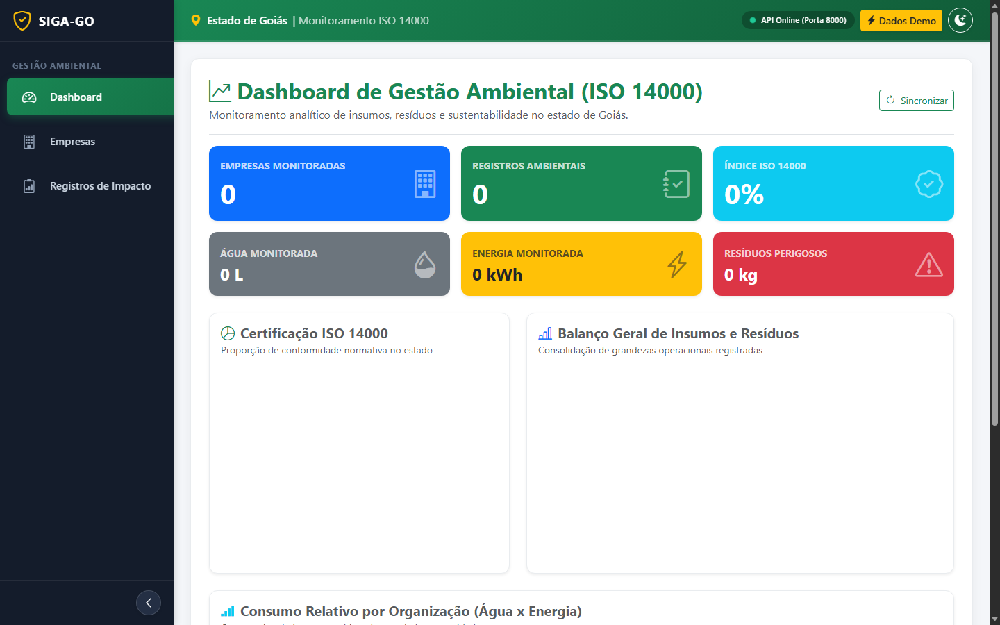
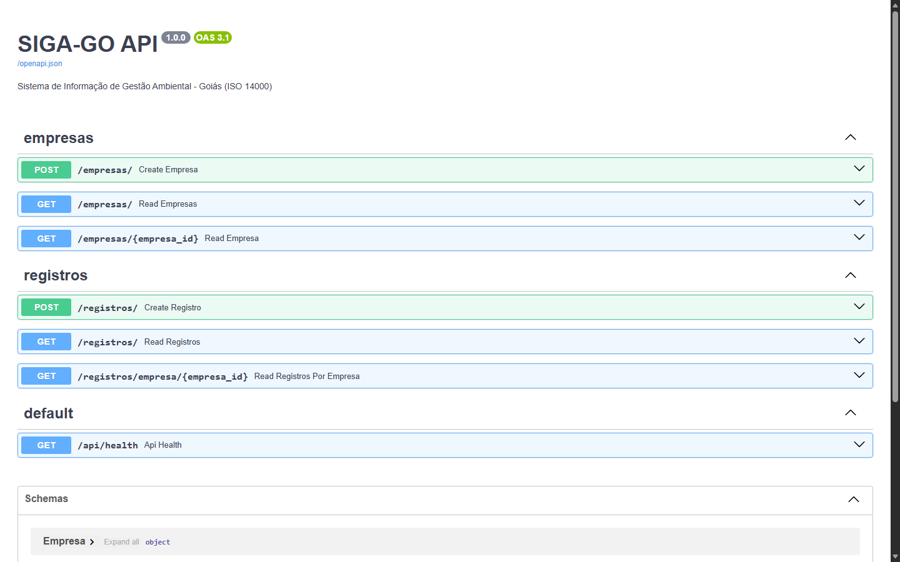
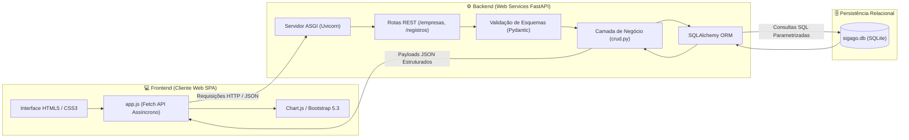

<div align="center">

# 🌿 SIGA-GO
### Sistema de Informação de Gestão Ambiental — Estado de Goiás
**Plataforma Distribuída de Monitoramento de Recursos e Conformidade com a NBR ISO 14000**

[](https://fastapi.tiangolo.com)
[](https://www.python.org/)
[](https://www.sqlite.org/)
[](https://getbootstrap.com/)
[](https://www.chartjs.org/)
[](https://github.com/cezarbtw/SIGA-GO)
[](LICENSE)

<br>

<p align="center">
  <a href="#-visão-geral">Visão Geral</a> •
  <a href="#-demonstração-visual">Demonstração Visual</a> •
  <a href="#-principais-recursos">Recursos</a> •
  <a href="#-arquitetura-do-sistema">Arquitetura</a> •
  <a href="#-especificação-dos-web-services">Web Services</a> •
  <a href="#-como-executar">Como Executar</a> •
  <a href="#-autor">Autor</a>
</p>

---

</div>

## 📌 Visão Geral

O **SIGA-GO (Sistema de Informação de Gestão Ambiental - Goiás)** é uma solução computacional moderna e distribuída concebida para auxiliar organizações industriais, agroindústrias, cooperativas e entidades fiscalizadoras no estado de Goiás a monitorar, quantificar e auditar seus impactos ambientais com rigor e transparência.

O projeto foi desenvolvido sob as diretrizes normativas da família **NBR ISO 14000 (com ênfase na ISO 14001:2015)** e na Política Nacional de Resíduos Sólidos (Lei nº 12.305/2010), alinhando o ciclo iterativo **PDCA (*Plan-Do-Check-Act*)** à medição precisa de:
* 💧 **Consumo de Recursos Hídricos (Litros)**
* ⚡ **Consumo de Energia Elétrica (kWh)**
* 📦 **Geração de Resíduos Sólidos Recicláveis/Comuns (kg)**
* ☣️ **Geração e Destinação de Resíduos Perigosos e Químicos (kg)**
* ♻️ **Documentação de Ações Mitigatórias e Melhoria Contínua**

---

## 📸 Demonstração Visual

### 📊 Painel Analítico & Dashboard Executivo
Interface moderna com **Sidebar Retrátil (estilo TCM-GO)**, cards de métricas em tempo real, suporte nativo a **Dark Mode** e gráficos interativos via **Chart.js**:



<br>

### 📑 Documentação Viva dos Web Services (OpenAPI / Swagger UI)
Todos os endpoints RESTful implementados no backend são autodocumentados e testáveis interativamente na rota `/docs`:



---

## ✨ Principais Recursos

### 🎨 Frontend Moderno (SPA — Single Page Application)
* **Sidebar Lateral Retrátil (estilo TCM-GO):** Barra de navegação elegante em *Dark Slate* com alternador circular (`<` / `>`) que recolhe a barra para o modo compacto de ícones (72px) ou a expande (250px), adaptando os gráficos automaticamente.
* **Dashboard Interativo com Chart.js:**
  * 🍩 *Gráfico Donut:* Percentual de conformidade das empresas com a NBR ISO 14000.
  * 📊 *Gráfico de Barras Verticais:* Balanço consolidado de insumos e resíduos no estado.
  * 📈 *Gráfico Comparativo:* Ranking relativo de consumo de água e energia por organização.
* **Filtros e Busca Instantânea:** Busca textual dinâmica por Nome, CNPJ ou Cidade, combinada a filtros de status sem recarregamento da tela.
* **Classificação de Risco Ambiental:** Etiquetas automáticas categorizando medições em *Alto Risco Químico*, *Médio Impacto* ou *Monitorado*.
* **Modal de Histórico Individual:** Visualização detalhada do histórico de lançamentos e acumulados de cada empresa com 1 clique.
* **🌙 Dark / Light Mode:** Alternância instantânea de tema com persistência automática no `localStorage`.
* **📥 Exportação para Excel (CSV):** Exportação formatada com codificação `UTF-8 BOM` (`\uFEFF`) para compatibilidade perfeita com acentuação no Microsoft Excel.
* **⚡ Modo Simulação (Dados Demo de Goiás):** Permite testar e apresentar a interface completa com empresas reais de Goiás mesmo se o servidor backend local estiver desligado.

### ⚙️ Backend & Web Services (FastAPI + SQLAlchemy)
* **Arquitetura RESTful Stateless:** Endpoints sem retenção de estado, aderentes às restrições de Roy Fielding.
* **Engenharia Defensiva de Dados:** Validações rigorosas com **Pydantic v2**, impedindo valores negativos (`ge=0`) e bloqueando duplicidade de CNPJs (retorno semântico `HTTP 400`).
* **Mapeamento Objeto-Relacional (ORM):** Isolamento de transações SQL através do **SQLAlchemy**, blindando o sistema contra ataques de *SQL Injection*.
* **Persistência Relacional Confiável:** Banco de dados SQLite com integridade referencial (`ForeignKey`) e propriedades ACID.
* **Hospedagem Unificada:** O FastAPI serve tanto os endpoints de API quanto os arquivos estáticos do frontend diretamente na porta `8000`.

---

## 🏛️ Arquitetura do Sistema



---

## 🔌 Especificação dos Web Services

| Método | Endpoint | Descrição | Status Sucesso | Erros Mapeados |
| :---: | :--- | :--- | :---: | :---: |
| `GET` | `/` | Servidor do Frontend integrado (SPA) | `200 OK` | `500` |
| `GET` | `/api/health` | Health Check e monitoramento de disponibilidade | `200 OK` | `500` |
| `GET` | `/empresas/` | Listagem paginada de organizações monitoradas | `200 OK` | `500` |
| `POST` | `/empresas/` | Cadastro de nova organização (valida duplicidade de CNPJ) | `200 OK` | `400 Bad Request` |
| `GET` | `/empresas/{id}` | Recupera os detalhes de uma organização específica | `200 OK` | `404 Not Found` |
| `GET` | `/registros/` | Listagem de todos os registros de impacto ambiental | `200 OK` | `500` |
| `POST` | `/registros/` | Lançamento de métrica ambiental vinculada à empresa | `200 OK` | `404 Not Found`, `422 Unprocessable` |
| `GET` | `/registros/empresa/{id}` | Histórico de lançamentos filtrados por empresa | `200 OK` | `404 Not Found` |
| `GET` | `/docs` | Documentação OpenAPI interativa (Swagger UI) | `200 OK` | - |

---

## 🚀 Como Executar

### Pré-requisitos
* **Python 3.10 ou superior** instalado ([python.org](https://www.python.org/))
* Navegador moderno (Google Chrome, Microsoft Edge, Firefox, Brave)

---

### Opção 1: Execução com 1 Clique (Recomendada no Windows)
Na pasta raiz do projeto, basta dar um **duplo clique** no arquivo:
```cmd
iniciar_projeto.bat
```
> O script inicia automaticamente o servidor backend na porta `8000` e abre a aplicação no seu navegador padrão!

---

### Opção 2: Execução Manual via Terminal

1. **Clone o repositório:**
   ```bash
   git clone https://github.com/cezarbtw/SIGA-GO.git
   cd SIGA-GO
   ```

2. **Crie e ative o ambiente virtual:**
   ```powershell
   # Windows (PowerShell)
   python -m venv backend/venv
   .\backend\venv\Scripts\activate

   # Linux / macOS
   python3 -m venv backend/venv
   source backend/venv/bin/activate
   ```

3. **Instale as dependências:**
   ```bash
   pip install -r backend/requirements.txt
   ```

4. **Inicie o servidor Web Services:**
   ```bash
   cd backend
   uvicorn main:app --reload --host 127.0.0.1 --port 8000
   ```

5. **Acesse a aplicação:**
   * 🌐 **Aplicação Web:** [http://127.0.0.1:8000](http://127.0.0.1:8000)
   * 📑 **Swagger UI:** [http://127.0.0.1:8000/docs](http://127.0.0.1:8000/docs)
   * 📊 **OpenAPI JSON:** [http://127.0.0.1:8000/openapi.json](http://127.0.0.1:8000/openapi.json)

---

## 📂 Estrutura de Diretórios

```text
SIGA-GO/
├── backend/
│   ├── routers/
│   │   ├── empresas.py           # Endpoints de organizações / stakeholders
│   │   └── registros.py          # Endpoints de medições de impacto ambiental
│   ├── crud.py                   # Funções de persistência e consulta (ORM)
│   ├── database.py               # Configuração da Session e Engine SQLite
│   ├── main.py                   # Ponto de entrada FastAPI e montagem estática
│   ├── models.py                 # Mapeamento declarativo das tabelas relacionais
│   ├── schemas.py                # Esquemas e regras defensivas de validação (Pydantic)
│   ├── sigago.db                 # Banco relacional SQLite oficial com dados iniciais
│   └── requirements.txt          # Manifesto de bibliotecas e versões
├── frontend/
│   ├── app.js                    # Lógica assíncrona, Chart.js, filtros e eventos
│   ├── index.html                # Interface SPA estruturada com sidebar retrátil
│   └── style.css                 # Estilos visuais personalizados e temas Dark/Light
├── docs/
│   └── screenshots/              # Capturas de tela para documentação oficial
├── generate_docx.py              # Utilitário para geração de relatórios técnicos
├── iniciar_projeto.bat           # Executável de 1 clique para inicialização no Windows
├── Relatorio_APS_SIGA_GO_UNIP.docx # Documentação técnica detalhada do projeto
└── README.md                     # Documentação oficial do projeto
```

---

## 👤 Autor

Desenvolvido exclusivamente por **Abraão Cezar Inácio Leopoldino**.

[](https://github.com/cezarbtw)
[](mailto:abraaocezarIL@outlook.com)

---

## 📄 Licença

Este projeto está sob a licença [MIT](LICENSE).

---

<div align="center">
  <sub>Desenvolvido com dedicação técnica em prol da preservação ambiental e da sustentabilidade corporativa em Goiás.</sub>
</div>
